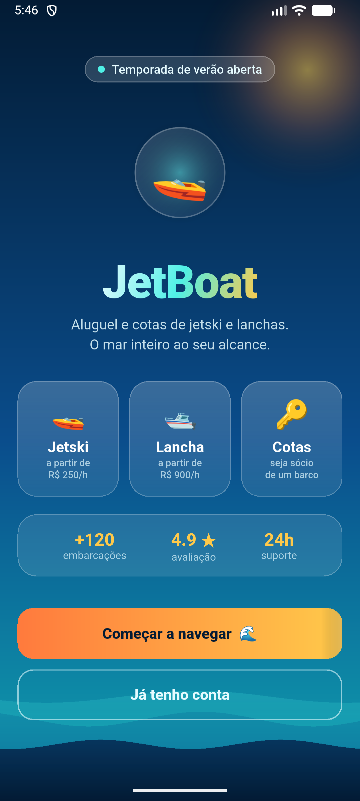
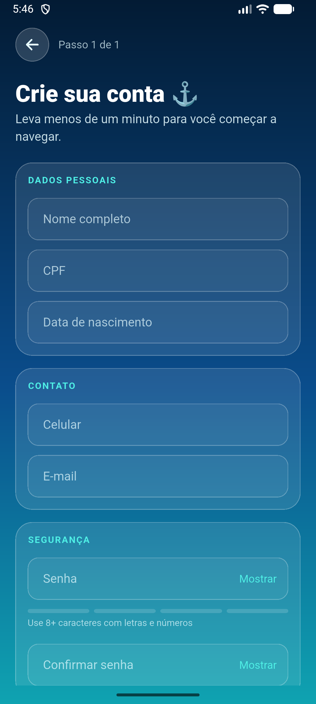
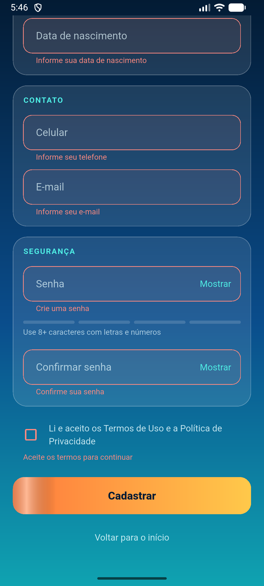
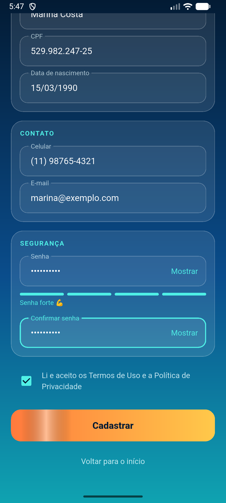
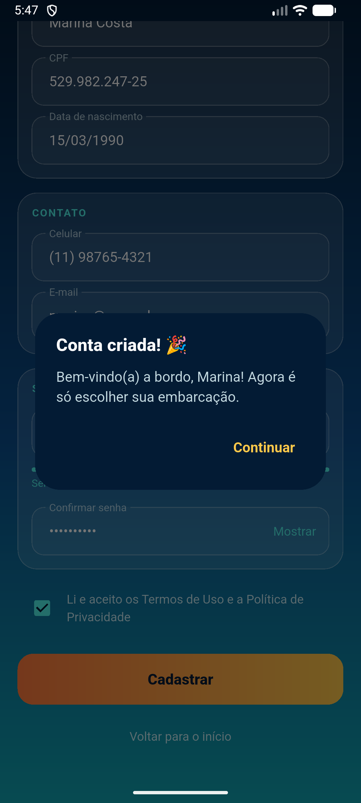
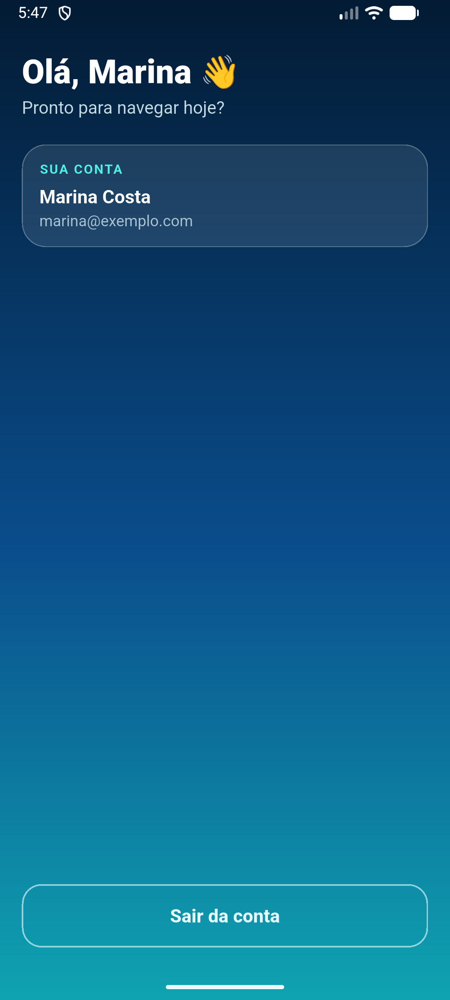
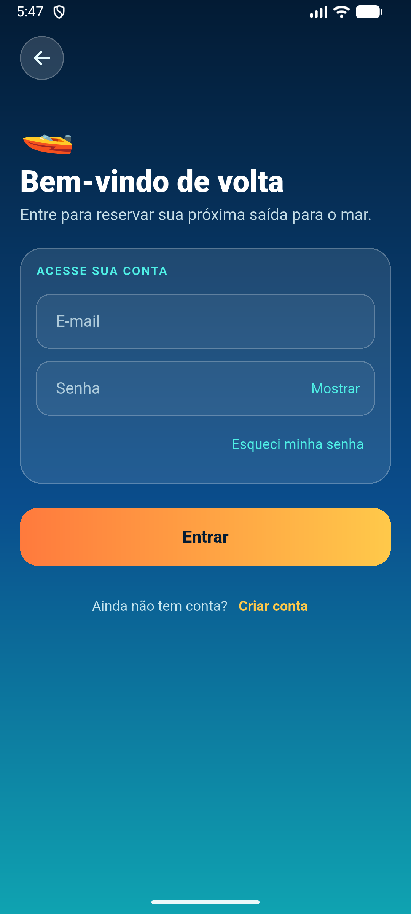
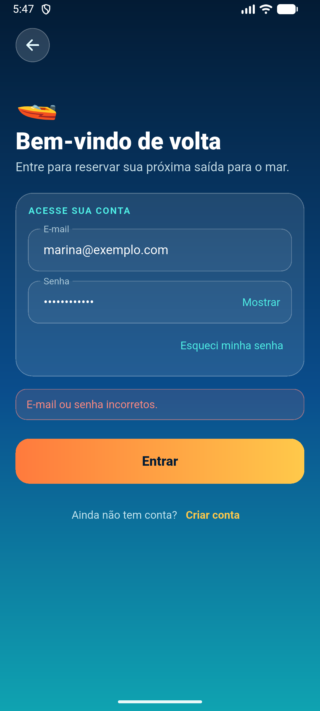

# JetBoat

Aluguel e cotas de jetski e lanchas. App em **Flutter + Dart** (Material 3) para **Android e iOS**.

> **Estado atual:** protótipo funcional de conta de usuário (cadastro, login, sessão e área logada). Ainda **não há servidor**: tudo roda e fica guardado no próprio aparelho. Veja [Limitações](#limitações-conhecidas).

**Sumário:** [Telas](#telas) · [O que já funciona](#o-que-já-funciona) · [Pré-requisitos](#pré-requisitos) · [Como rodar, passo a passo](#como-rodar-passo-a-passo) · [Testes](#testes) · [Gerar o APK](#gerar-o-apk) · [Problemas comuns](#problemas-comuns) · [Estrutura do projeto](#estrutura-do-projeto) · [Documentação](#documentação) · [Limitações conhecidas](#limitações-conhecidas)

---

## Telas

Capturas do app rodando no emulador Android (Android 17, 1080 × 2400). Os dados mostrados são fictícios.

<table>
  <tr>
    <td align="center"><br><sub><b>Inicial</b><br>apresentação animada e categorias</sub></td>
    <td align="center"><br><sub><b>Cadastro</b><br>dados pessoais, contato e segurança</sub></td>
    <td align="center"><br><sub><b>Cadastro com erros</b><br>validação campo a campo</sub></td>
    <td align="center"><br><sub><b>Cadastro preenchido</b><br>máscaras e força da senha</sub></td>
  </tr>
  <tr>
    <td align="center"><br><sub><b>Conta criada</b><br>confirmação; já entra logado</sub></td>
    <td align="center"><br><sub><b>Painel</b><br>área logada e sair da conta</sub></td>
    <td align="center"><br><sub><b>Login</b><br>e-mail e senha</sub></td>
    <td align="center"><br><sub><b>Login com erro</b><br>mensagem genérica, sem revelar se o e-mail existe</sub></td>
  </tr>
</table>

O visual segue o design system do projeto: [`docs/DESIGN_SYSTEM.md`](docs/DESIGN_SYSTEM.md).

---

## O que já funciona

| Tela | O que faz |
|---|---|
| **Inicial** | Apresentação animada (ondas, sol, barco), categorias Jetski / Lancha / Cotas, botões "Começar a navegar" (cadastro) e "Já tenho conta" (login). |
| **Cadastro** | Nome, CPF, data de nascimento, celular, e-mail, senha e confirmação, com máscaras e validação de cada campo. Indicador de força da senha. Aceite dos termos. Ao concluir, a conta é criada e **a pessoa já entra logada**. |
| **Login** | E-mail e senha, com mensagem de erro genérica (não revela se o e-mail existe). Após **5 senhas erradas**, o e-mail fica bloqueado por **30 segundos**, com contagem regressiva no botão. |
| **Painel** (área logada) | Saudação, dados da conta e "Sair da conta". |

**Regras do cadastro:**
- CPF válido (dígitos verificadores) e **único**: não pode haver duas contas com o mesmo CPF.
- E-mail válido e **único**, sem diferenciar maiúsculas (`Ana@Teste.com` = `ana@teste.com`).
- Idade mínima de 18 anos.
- Celular com DDD válido.
- Senha com 8 caracteres ou mais, com letras e números.

**Sessão (JWT):**
- **Token de acesso:** vale 15 minutos e é renovado automaticamente.
- **Token de renovação:** vale 7 dias e é trocado a cada uso.
- Ao fechar e reabrir o app, a sessão continua. Se ela vencer de vez, o app volta ao login com o aviso "Sua sessão expirou".

**Segurança no aparelho:**
- A senha nunca é guardada, só um hash PBKDF2 com salt.
- A chave dos tokens e os próprios tokens ficam no armazenamento seguro do sistema (Android Keystore / iOS Keychain).

**Ainda não implementado** (o app mostra "em breve"): recuperação de senha e a lista de ofertas ao tocar numa categoria.

---

## Pré-requisitos

| Ferramenta | Versão usada no projeto | Para quê |
|---|---|---|
| [Flutter SDK](https://docs.flutter.dev/get-started/install) | **3.47.9** (stable), que inclui o **Dart 3.13.7** | compilar e rodar o app |
| [Android Studio](https://developer.android.com/studio) | qualquer versão recente | traz o Android SDK, o emulador e o JDK (pasta `jbr`) |
| Aparelho ou emulador Android | **Android 7.0 (API 24) ou mais novo** | rodar o app |
| Mac com Xcode | — | **só para iOS**: no Windows, apenas Android |

Também ajuda instalar a extensão **Flutter** no VS Code ou o plugin **Flutter** no Android Studio, para rodar com F5 e ter o hot reload pelo editor.

---

## Como rodar, passo a passo

Os comandos abaixo valem para o terminal (PowerShell, Git Bash ou o terminal do VS Code), dentro da pasta do projeto.

### 1. Instalar o Flutter

1. Baixe o Flutter 3.47.9 em <https://docs.flutter.dev/release/archive> e extraia numa pasta **sem espaços nem acentos** no caminho (exemplo no Windows: `C:\dev\flutter`).
2. Adicione a pasta `bin` ao `PATH` do usuário (no exemplo: `C:\dev\flutter\bin`).
3. **Feche e abra o terminal** (ou o VS Code) e confira:

   ```sh
   flutter --version
   ```

   Deve mostrar `Flutter 3.47.9` e `Dart 3.13.7`.

### 2. Ligar o Flutter ao Android

Se o Android Studio estiver instalado no lugar padrão, normalmente o Flutter acha tudo sozinho. Se não achar (ou se aparecer `JAVA_HOME is not set`), aponte manualmente. No Windows, com o Android Studio no caminho padrão:

```sh
flutter config --jdk-dir "C:\Program Files\Android\Android Studio\jbr"
flutter config --android-sdk "%LOCALAPPDATA%\Android\Sdk"
```

Aceite as licenças do Android e confira o ambiente:

```sh
flutter doctor --android-licenses
flutter doctor
```

No `flutter doctor`, o item **Android toolchain** precisa estar sem erro. Avisos sobre Chrome, Visual Studio ou Xcode podem ser ignorados se você só vai rodar no Android.

### 3. Abrir um emulador (ou conectar um celular)

**Emulador:**
1. No Android Studio, abra **Device Manager**.
2. Se ainda não houver um aparelho virtual, crie um (por exemplo Medium Phone, API 37) e clique em ▶.
3. Também dá para abrir pelo terminal:

   ```sh
   flutter emulators                                    # lista os emuladores
   flutter emulators --launch Medium_Phone_API_37.0     # abre um deles
   ```

**Celular de verdade:**
1. Ative as **Opções do desenvolvedor** e a **Depuração USB**.
2. Conecte o cabo e aceite o pedido de autorização no celular.

**Para conferir:** rode `flutter devices`. O aparelho deve aparecer na lista, por exemplo `emulator-5554`.

### 4. Baixar as dependências do projeto

```sh
flutter pub get
```

### 5. Rodar o app

```sh
flutter run
```

Se houver mais de um aparelho conectado, escolha um com `-d`:

```sh
flutter run -d emulator-5554
```

A **primeira compilação demora bastante** (cerca de 10 a 15 minutos), porque o Gradle e componentes do Android são baixados. As seguintes levam poucos segundos.

Com o app rodando, o terminal aceita os comandos:

| Tecla | O que faz |
|---|---|
| `r` | hot reload: aplica a mudança no código sem perder o estado |
| `R` | hot restart: reinicia o app |
| `q` | encerra |

Pelo VS Code: abra a pasta do projeto, escolha o aparelho na barra de status (canto inferior direito) e aperte **F5**.

### 6. Primeiro uso

1. Na tela inicial, toque em **Começar a navegar**.
2. Preencha o cadastro. O CPF precisa ser válido; para teste, use `529.982.247-25` ou `111.444.777-35`. A data de nascimento precisa indicar 18 anos ou mais.
3. Aceite os termos e toque em **Cadastrar**. A conta é criada e você cai no painel já logado.
4. Toque em **Sair da conta** e entre de novo por **Já tenho conta**.

As contas ficam só naquele aparelho. Para começar do zero, apague os dados do app em **Configurações → Apps → JetBoat → Armazenamento → Limpar dados**.

---

## Testes

```sh
flutter analyze                                      # análise estática: deve dar "No issues found!"
flutter test                                         # 62 testes no computador (não precisam de aparelho)
flutter test integration_test -d emulator-5554       # 7 testes no aparelho/emulador
```

| Onde | O que cobre |
|---|---|
| `test/` | regras do cadastro, máscaras, hash de senha (compatível com a versão Kotlin anterior), JWT, autenticação (login, bloqueio, renovação, expiração), repositório de usuários, as telas e a **arquitetura** (`arquitetura_test.dart`, que falha se uma pasta importar o que não pode) |
| `integration_test/` | o app inteiro no aparelho: navegação, voltar do sistema, fluxo cadastro → painel → sair → login → reabrir logado, chave no Keystore e gravação no armazenamento interno |

> **Atenção:** os testes de integração **reinstalam o app e apagam os dados dele** no aparelho (contas e sessão). Não rode num celular com dados que você queira manter.

---

## Gerar o APK

```sh
flutter build apk --release
```

O arquivo sai em `build/app/outputs/flutter-apk/app-release.apk`. Para instalar no aparelho conectado:

```sh
flutter install
```

> O APK de release ainda é assinado com a **chave de debug** (padrão do Flutter). Antes de publicar na Play Store, é preciso criar uma chave própria de assinatura.

---

## Problemas comuns

| Sintoma | Causa e solução |
|---|---|
| `flutter` não é reconhecido como comando | o `bin` do Flutter não está no `PATH`, ou o terminal foi aberto antes de adicionar. Feche e abra o terminal (ou o VS Code). |
| `JAVA_HOME is not set` ao compilar | aponte o JDK do Android Studio: `flutter config --jdk-dir "<pasta do Android Studio>\jbr"`. |
| `flutter doctor` reclama de licenças do Android | rode `flutter doctor --android-licenses` e aceite todas. |
| `No supported devices connected` | o emulador não está aberto ou o celular não autorizou a depuração USB. Confira com `flutter devices`. |
| Tela preta por alguns segundos ao abrir | normal no **modo debug**, que é mais lento para iniciar. Em `--release` abre rápido. |
| A primeira compilação parece travada em `Running Gradle task 'assembleDebug'` | é o download inicial do Gradle e do Android. Espere; pode levar mais de 10 minutos na primeira vez. |
| Conta criada antes "sumiu" | os testes de integração ou o "Limpar dados" apagam as contas. Elas existem só no aparelho. |

---

## Estrutura do projeto

A organização segue o modelo C4 descrito em [`docs/ARQUITETURA_C4.md`](docs/ARQUITETURA_C4.md).

| Pasta | Componente C4 | Conteúdo |
|---|---|---|
| `lib/main.dart`, `lib/app.dart`, `lib/dependencias.dart` | Shell | inicialização, rotas, transição entre telas e montagem dos objetos |
| `lib/ui/theme/` | Design system | tokens: cores, tipografia e tema, espaçamentos, movimento |
| `lib/ui/components/` | Design system | widgets compartilhados (`TelaBase`, botões, `CartaoVidro`, campos, máscaras) |
| `lib/ui/<tela>/` | Telas | `home`, `cadastro`, `login`, `painel` |
| `lib/domain/` | Domínio | Dart puro: `Perfil`, interface `Autenticacao`, resultados e validações |
| `lib/data/` | Dados | usuários (arquivo JSON local), hash de senha e, em `auth/`, a autenticação JWT |
| `test/` | — | testes no computador |
| `integration_test/` | — | testes no aparelho ou emulador |
| `docs/` | — | arquitetura, design system, prompt de design e as imagens das telas (`docs/imagens/`) |

As regras entre as pastas (por exemplo, "telas não importam `lib/data/`") são verificadas automaticamente pelo `test/arquitetura_test.dart` a cada `flutter test`.

---

## Documentação

| Documento | Para quê |
|---|---|
| [`docs/ARQUITETURA_C4.md`](docs/ARQUITETURA_C4.md) | arquitetura nos 4 níveis do C4: situação atual, alvo, regras de dependência e lista de correções com status |
| [`docs/DESIGN_SYSTEM.md`](docs/DESIGN_SYSTEM.md) | cores, tipografia, espaçamento, elevação, iconografia, movimento, widgets, checklist de revisão e o que falta definir |
| [`docs/PROMPT_DESIGN_SYSTEM_JETBOAT.md`](docs/PROMPT_DESIGN_SYSTEM_JETBOAT.md) | prompt para pedir telas novas ao Claude seguindo o design system e a arquitetura |
| [`docs/prompts/`](docs/prompts/) | prompts de design (área Design do Claude) e de sistema e desenvolvimento (requisitos da plataforma completa) |

Os diagramas dos documentos são em Mermaid: aparecem desenhados no GitHub e no VS Code com a extensão **Markdown Preview Mermaid Support**.

---

## Limitações conhecidas

- **Sem servidor:** as contas ficam em `usuarios.json` no armazenamento interno do aparelho, e o próprio app emite e confere os tokens JWT. Uma conta criada num celular não existe em outro. A ida para uma API está planejada no `docs/ARQUITETURA_C4.md` (seção 8, bloco A).
- **Bloqueio de tentativas:** o bloqueio de login fica em memória e zera ao fechar o app.
- **iOS:**
  - O projeto tem a pasta `ios/`, mas só foi compilado e testado no Android; para iOS é preciso um Mac com Xcode.
  - No iPhone, o gesto de arrastar da borda para voltar não funciona (só o botão de voltar da tela).
  - A tela de abertura do iOS ainda é branca, e o ícone do app é o padrão do Flutter.
- **Contas da versão Kotlin:** o app nasceu em Kotlin e foi migrado para Flutter. As contas criadas na versão antiga continuam entrando, porque o formato do arquivo e o hash de senha são os mesmos. O backup do código Kotlin está em `AndroidStudioProjects/JetBoat_kotlin_backup.zip`.
