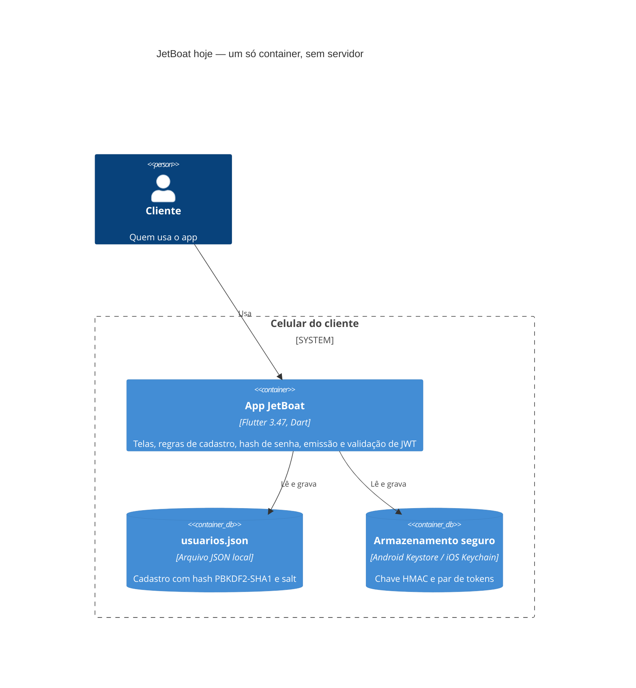
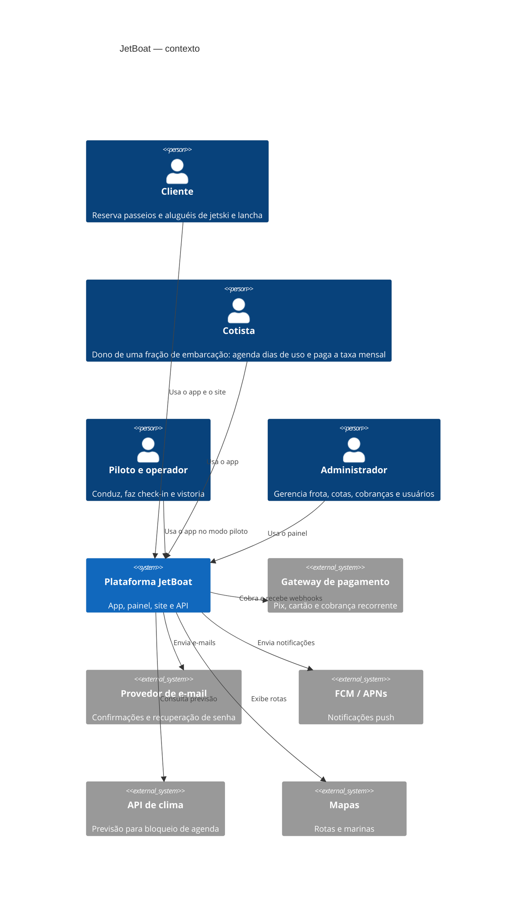
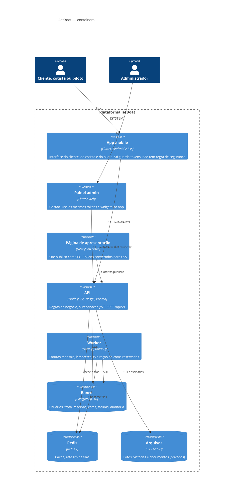
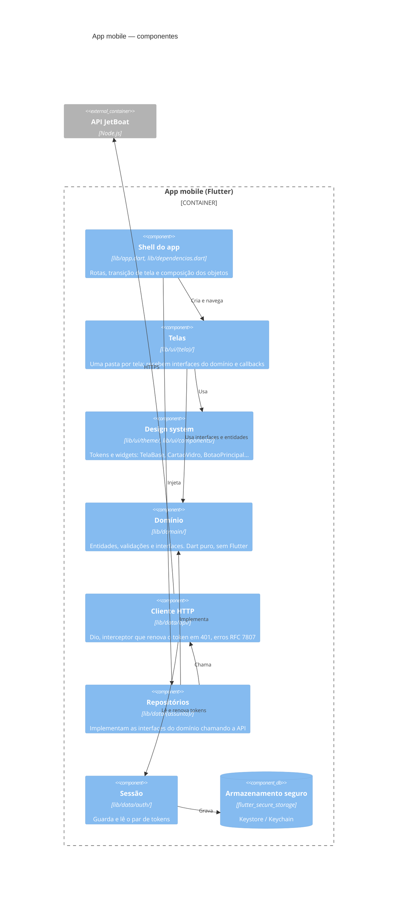
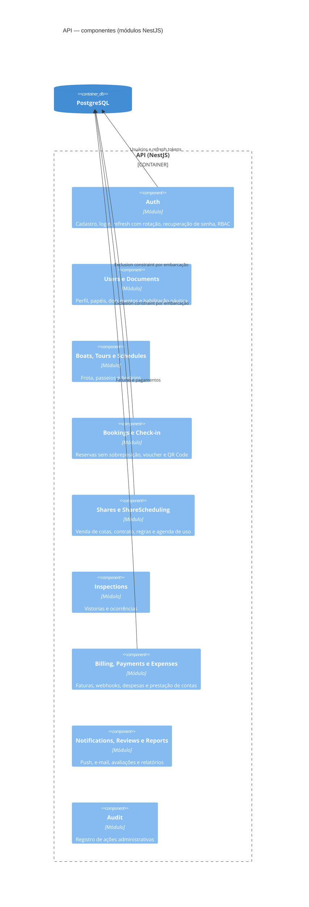

# Arquitetura — JetBoat (modelo C4)

Mapa da arquitetura do JetBoat nos quatro níveis do modelo C4: **contexto → containers → componentes → código**. O documento mostra o que existe hoje (**atual**), onde queremos chegar (**alvo**) e a lista de correções para ir de um ao outro.

**Última revisão:** 11/11/2026 · **Relacionados:** [`DESIGN_SYSTEM.md`](DESIGN_SYSTEM.md) (a seção 13 mostra onde o design system fica nesta arquitetura) · ADRs em `docs/adr/` (a criar)

> **Como manter:** toda mudança que crie ou remova um container, um componente ou uma pasta de `lib/` atualiza este arquivo no mesmo PR. Os diagramas são Mermaid e aparecem renderizados no GitHub, no VS Code (extensão Markdown Preview Mermaid) e no Android Studio (plugin Mermaid).

**Sumário:** [1. Situação atual](#1-situação-atual) · [2. Nível 1 — Contexto](#2-nível-1--contexto-alvo) · [3. Nível 2 — Containers](#3-nível-2--containers-alvo) · [4. Nível 3 — Componentes do app](#4-nível-3--componentes-do-app-mobile-alvo) · [5. Nível 3 — Componentes da API](#5-nível-3--componentes-da-api-alvo) · [6. Nível 4 — Código](#6-nível-4--código-do-app-alvo) · [7. Regras de dependência](#7-regras-de-dependência) · [8. Correções](#8-correções-do-atual-para-o-alvo) · [9. Decisões em aberto](#9-decisões-em-aberto) · [10. Histórico](#10-histórico)

---

## 1. Situação atual

Hoje o JetBoat tem **um único container**: o app Flutter. Não existe servidor.

- Os usuários ficam em `usuarios.json`, no armazenamento interno do app (é o mesmo formato da versão Kotlin).
- A senha vira hash **PBKDF2-HMAC-SHA1, 10.000 iterações** (`lib/data/senha.dart`).
- O próprio app **emite e confere os tokens JWT** (HS256), com uma chave HMAC gerada no aparelho e guardada no Keystore/Keychain (`lib/data/auth/`).
- As **camadas do app já seguem o alvo** (bloco B da seção 8): domínio em `lib/domain/`, implementações em `lib/data/`, telas só com a interface `Autenticacao`, regras verificadas por `test/arquitetura_test.dart`.
- O limite de 5 tentativas de login fica **em memória** e zera quando o app é fechado.

O código desta camada é cuidadoso: tem salt, comparação em tempo constante, rejeita `alg: none`, faz rotação do refresh token e grava em arquivo temporário antes de renomear. **Mas o desenho não protege nada fora do aparelho.** O token só prova a identidade para o próprio app, e a conta de uma pessoa só existe no celular dela. A correção principal (seção 8, itens A1 a A4) é levar a autenticação e os dados para uma API.

### 1.1 Containers hoje



### 1.2 Componentes do app hoje

| Componente | Arquivos | Papel hoje | Destino no alvo |
|---|---|---|---|
| Shell | `lib/main.dart`, `lib/app.dart` (`JetBoatApp`, `Rotas`, `_RotaFade`), `lib/dependencias.dart` | navegação, transição e montagem dos objetos | ✅ **já no alvo**; falta a URL da API por `--dart-define` (B4) |
| Design system | `lib/ui/theme/`, `lib/ui/components/` (inclui `mascara.dart`) | tokens e widgets | ✅ **já no alvo** |
| Telas | `lib/ui/home`, `cadastro`, `login`, `painel` | interface; recebem `Autenticacao` | ✅ **já no alvo** |
| Domínio da conta | `lib/domain/conta/` (`perfil.dart`, `autenticacao.dart`, `resultados.dart`, `validador_cadastro.dart`) | `Perfil` sem hash, interface `Autenticacao`, resultados `sealed`, validações | ✅ **já no alvo** |
| Repositório de usuários | `lib/data/repositorio_usuarios.dart` (interface interna da camada `data`), `repositorio_usuarios_arquivo.dart`, `usuario.dart`, `fila.dart` | cadastro em arquivo JSON | **substituído** pela API (`fila.dart` pode ficar) |
| Hash de senha | `lib/data/senha.dart` | PBKDF2 no aparelho | **sai do app** (Argon2id na API) |
| Emissão e validação de JWT | `lib/data/auth/jwt.dart`, `assinador.dart` | o app emite e confere os próprios tokens | **sai do app** (a API emite) |
| Autenticação | `lib/data/auth/autenticacao_local.dart` (implementa `Autenticacao`) | login, cadastro com sessão, renovação, bloqueio de tentativas | **reescrita** como `AutenticacaoApi`, cliente da API |
| Sessão e armazenamento seguro | `lib/data/auth/sessao_armazenamento.dart`, `armazenamento_seguro.dart` | guarda os tokens | **fica** |

---

## 2. Nível 1 — Contexto (alvo)



---

## 3. Nível 2 — Containers (alvo)



O pacote `packages/design_tokens` não é container: é uma biblioteca compartilhada, gerada a partir do `DESIGN_SYSTEM.md`, que entrega os mesmos tokens ao app, ao painel e ao site (ver seção 13 do `DESIGN_SYSTEM.md`).

---

## 4. Nível 3 — Componentes do app mobile (alvo)



| Componente | Pode depender de | Não pode depender de |
|---|---|---|
| Design system (`ui/theme`, `ui/components`) | Flutter; `ui/theme` dentro de `ui/components` | `domain`, `data`, telas |
| Telas (`ui/<tela>`) | design system, `domain` | `data`, outras telas |
| Domínio (`domain`) | só Dart | Flutter, `ui`, `data` |
| Dados (`data`) | `domain`, pacotes de rede e armazenamento | `ui` |
| Shell (`app.dart`, `dependencias.dart`) | tudo | — |

---

## 5. Nível 3 — Componentes da API (alvo)



Os requisitos de cada módulo estão no `JetBoat-Prompt-Sistema-e-Desenvolvimento.md`.

---

## 6. Nível 4 — Código do app (alvo)

O alvo mantém os caminhos do design system (`lib/ui/theme/`, `lib/ui/components/`) e acrescenta só `lib/domain/` e `lib/data/api/`, para mudar o mínimo.

```
lib/
├── main.dart
├── app.dart                         # Rotas, _RotaFade, JetBoatApp
├── dependencias.dart                # composição: cria repositórios, cliente HTTP e sessão
├── domain/                          # Dart puro
│   ├── conta/
│   │   ├── perfil.dart              # id, nome, CPF, nascimento, telefone, e-mail (sem hash)
│   │   ├── autenticacao.dart        # interface: entrar, cadastrar, sessaoAtual, sair, recuperarSenha
│   │   ├── resultados.dart          # ResultadoLogin, ResultadoCadastro (sealed)
│   │   └── validador_cadastro.dart  # movido de ui/cadastro
│   └── (reservas, cotas, frota…)    # um diretório por assunto, quando existir
├── data/
│   ├── api/
│   │   ├── api_cliente.dart         # Dio, URL por --dart-define, interceptor de 401
│   │   └── problema.dart            # erros RFC 7807 → resultados do domínio
│   ├── auth/
│   │   ├── autenticacao_api.dart    # implementa domain/conta/autenticacao.dart
│   │   ├── sessao_armazenamento.dart
│   │   └── armazenamento_seguro.dart
│   └── fila.dart                    # garante uma renovação de token por vez
└── ui/
    ├── theme/                       # design system: tokens
    ├── components/                  # design system: widgets (+ mascara.dart)
    ├── home/ cadastro/ login/ painel/
    └── (novas telas)
```

**Saem do app:** `data/senha.dart`, `data/auth/jwt.dart`, `data/auth/assinador.dart`, `data/repositorio_usuarios.dart`, `data/repositorio_usuarios_arquivo.dart` e `data/usuario.dart`. Os testes `jwt_test`, `senha_test` e `repositorio_usuarios_arquivo_test` passam a ser testes da API.

---

## 7. Regras de dependência

1. **Telas não importam `lib/data/`.** Recebem interfaces do domínio (`Autenticacao`) e callbacks.
2. **Telas não importam outras telas.** O que for comum vai para `ui/components/` ou para `domain/` (é o caso do `validador_cadastro.dart`, usado pelo cadastro e pelo login).
3. **O design system não conhece regra de negócio.** `ui/theme` e `ui/components` não importam `domain` nem `data`.
4. **O domínio é Dart puro**, sem `package:flutter`, para ser testado sem aparelho.
5. **Nenhum segredo nem regra de segurança no app.** O app guarda tokens e mostra estados. Quem decide é a API.
6. **Só o shell monta objetos.** `Dependencias` é o único lugar com `new` de implementações concretas.

As regras 1, 2, 3, 4 e 6 são verificadas por `test/arquitetura_test.dart`, que lê os `import` de cada arquivo em `lib/` e falha se alguma for quebrada. O mesmo teste também confere que:

- todo arquivo de `lib/` pertence a um componente conhecido (pasta nova exige atualizar o teste e este documento);
- os imports internos usam `package:jetboat/`, nunca caminho relativo;
- `lib/data/` não importa nada de `lib/ui/` nem do shell;
- telas e design system não usam pacotes de infraestrutura (`dart:io`, `path_provider`, `flutter_secure_storage`, `crypto`).

A regra 5 (nenhum segredo no app) não dá para verificar por import; ela depende do bloco A da seção 8.

---

## 8. Correções do atual para o alvo

Ordem sugerida: cada bloco termina com `flutter analyze` sem avisos, `flutter test` passando e o app funcionando.

### A. Segurança e containers (prioridade alta)

| # | Correção | Arquivos hoje | Status |
|---|---|---|---|
| A1 | Criar a API com o módulo Auth (cadastro, login, refresh com rotação, logout, `me`), Argon2id e rate limit | — | pendente |
| A2 | Trocar `AutenticacaoLocal` por `AutenticacaoApi`, que só chama a API e guarda os tokens. Remover a emissão e a validação de JWT no aparelho | `data/auth/autenticacao_local.dart`, `jwt.dart`, `assinador.dart` | pendente (depende de A1) |
| A3 | Levar o bloqueio por tentativas para a API (resposta 429 com `Retry-After`). O app só mostra o tempo restante | `autenticacao_local.dart` (`_falhas`, `_bloqueadoAte`) | pendente (depende de A1) |
| A4 | Parar de circular hash e salt pela interface: a `Sessao` passa a carregar um `Perfil`, não o `Usuario` com `senhaHash` | `domain/conta/perfil.dart`, `resultados.dart` | ✅ feito: `Usuario` (com hash) só existe dentro de `data/` |
| A5 | Decidir a migração das contas locais (seção 9) e apagar o `usuarios.json` e a chave HMAC do aparelho depois de migrar | `repositorio_usuarios_arquivo.dart`, `assinador.dart` | pendente |

### B. Camadas do app (prioridade média)

| # | Correção | Arquivos hoje | Status |
|---|---|---|---|
| B1 | Criar `lib/domain/conta/` com `Perfil`, a interface `Autenticacao` e os resultados `sealed` | `domain/conta/` | ✅ feito |
| B2 | Mover `validador_cadastro.dart` para `domain/conta/` e `mascara.dart` para `ui/components/` | `domain/conta/`, `ui/components/` | ✅ feito (as regras `normalizarEmail` e `normalizarCpf` também foram para o validador) |
| B3 | Fazer as telas receberem `Autenticacao` (interface) em vez das implementações | `tela_cadastro.dart`, `tela_login.dart`, `tela_painel.dart`, `app.dart` | ✅ feito. A regra "quem se cadastra já entra logado" saiu do `app.dart` e virou parte de `Autenticacao.cadastrar` |
| B4 | Tirar `Dependencias` de `app.dart` para `dependencias.dart`, com a URL da API vinda de `--dart-define` (dev, homologação, produção) | `dependencias.dart` | ✅ parte 1 feita; a URL entra com a API (B5) |
| B5 | Criar `data/api/api_cliente.dart` (Dio) com interceptor que renova o token em 401, uma renovação por vez (`Fila`) | novo | pendente (depende de A1) |
| B6 | Criar `test/arquitetura_test.dart` com as regras da seção 7 | `test/arquitetura_test.dart` | ✅ feito (9 verificações; seção 7) |
| B7 | Nos testes de tela, trocar o repositório real por um `Autenticacao` falso | `test/tela_*_test.dart`, `test/util.dart` | pendente |

### C. Funcionalidades pendentes (prioridade baixa)

| # | Correção | Onde |
|---|---|---|
| C1 | Recuperação de senha (hoje mostra "em breve") | `app.dart`, `onEsqueciSenha` |
| C2 | Categorias da tela inicial abrirem a lista de ofertas (hoje só mostram uma mensagem) | `app.dart`, `onCategoria` |
| C3 | Atualizar o `README.md`: a observação "ainda não há servidor" deixa de valer | `README.md` |

---

## 9. Decisões em aberto

| Decisão | Opções | Observação |
|---|---|---|
| Contas criadas só no aparelho | (a) pedir novo cadastro; (b) no primeiro login, o app envia e-mail e senha para a API, que cria a conta com Argon2id | Não há como migrar as contas sem a senha, porque o hash PBKDF2 está só no celular. Com poucos usuários de teste, (a) é mais simples |
| Validade do refresh token | 7 dias (como hoje no app) ou 30 dias (como no prompt de desenvolvimento) | Registrar em ADR |
| Gerência de estado | manter `StatefulWidget` + callbacks, ou adotar Riverpod | Registrar em ADR antes de mudar |

---

## 10. Histórico

| Data | Mudança |
|---|---|
| 11/11/2026 | Criado: situação atual (um container, autenticação no aparelho), diagramas C4 alvo dos níveis 1 a 3, estrutura de código alvo, regras de dependência e lista de correções. |
| 11/11/2026 | Código alinhado ao nível 4 (seção 6): feitos B1, B2, B3, B4 (parte 1), B6 e A4. Seção 1.2 passou a mostrar o código atual; seções 7 e 8 ganharam status e a lista do que o teste de arquitetura verifica. |
