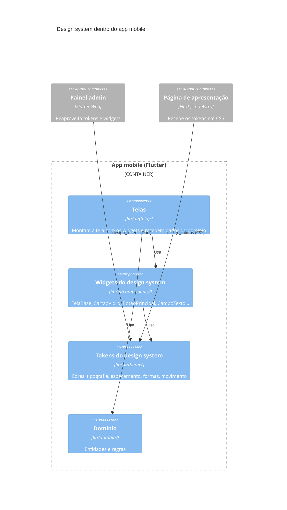

# Design System — JetBoat (Flutter)

Referência visual do app JetBoat em **Flutter + Dart**, para Android e iOS. Toda tela nova usa os tokens e widgets daqui. **Nenhum valor de cor, fonte, canto, espaçamento ou duração é escrito à mão**: se faltar um token, ele é criado aqui primeiro e depois no código.

**Última revisão:** 11/11/2026 · **Plataformas:** Android e iOS · **Framework:** Flutter 3.47 (Material 3) · **Tema:** só escuro

> **Status:** este documento descreve o código que existe hoje no projeto. O app foi migrado de Kotlin (Jetpack Compose) para Flutter com o mesmo visual e os mesmos valores, e a versão Kotlin foi removida. O código Kotlin e os documentos daquela versão estão em `AndroidStudioProjects/JetBoat_kotlin_backup.zip`.

> **Observação:** Os dois arquivos (`DESIGN_SYSTEM.md` e `PROMPT_DESIGN_SYSTEM_JETBOAT.md`) não se atualizam sozinhos. Quando mudar um token no `DESIGN_SYSTEM.md`, mude também no prompt, senão o Claude vai trabalhar com valores antigos.

**Sumário:** [Regras de ouro](#regras-de-ouro) · [Onde está no código](#onde-está-no-código) · [1. Identidade](#1-identidade) · [2. Cores](#2-cores) · [3. Tipografia](#3-tipografia) · [4. Espaçamento, formas e medidas](#4-espaçamento-formas-e-medidas) · [5. Elevação](#5-elevação) · [6. Iconografia](#6-iconografia) · [7. Movimento](#7-movimento) · [8. Widgets](#8-widgets) · [9. Android e iOS](#9-android-e-ios) · [10. Checklist de revisão](#10-checklist-de-revisão-de-tela) · [11. A definir](#11-a-definir) · [12. Correspondência com a versão Kotlin](#12-correspondência-com-a-versão-kotlin) · [13. Lugar na arquitetura (C4)](#13-lugar-na-arquitetura-c4) · [14. Histórico](#14-histórico)

---

## Regras de ouro

| ✅ Faça | ❌ Não faça |
|---|---|
| `color: textSecondary` | `color: Colors.white.withValues(alpha: 0.85)` |
| `style: context.texto.titleMedium` | `style: TextStyle(fontSize: 17, fontWeight: FontWeight.bold)` |
| `padding: const EdgeInsets.all(Espacamento.lg)` | `padding: const EdgeInsets.all(16)` |
| `borderRadius: Formas.cartao` | `borderRadius: BorderRadius.circular(22)` |
| `duration: Movimento.curta` | `duration: const Duration(milliseconds: 250)` |
| `CartaoVidro(children: [...])` para agrupar | `Container(color: oceanBlue)` como bloco sólido |
| `const SizedBox(height: Espacamento.xl)` | `const SizedBox(height: 24)` |
| `TelaBase(children: [...])` para montar a tela | `Scaffold` + degradê + `SafeArea` montados à mão |
| Um `BotaoPrincipal` por tela | Dois botões com degradê do sol na mesma tela |

---

## Onde está no código

Pacote base: `lib/`

| O quê | Arquivo | Conteúdo |
|---|---|---|
| Cores | `lib/ui/theme/cores.dart` | constantes de nível superior (`oceanDeep`, `textSecondary`…) |
| Tipografia e tema | `lib/ui/theme/tema.dart` | `tipografia` (o `TextTheme`) e `temaJetBoat` (o `ThemeData`) |
| Espaçamentos, formas e medidas | `lib/ui/theme/dimens.dart` | classes `Espacamento`, `Formas`, `Medidas` |
| Movimento | `lib/ui/theme/movimento.dart` | classe `Movimento` (durações e curva) |
| Widgets gerais | `lib/ui/components/componentes.dart` | `fundoOceano`, `TelaBase`, botões, cabeçalho, cartão, aviso, `mostrarMensagem`, atalho `context.texto` |
| Campos de formulário | `lib/ui/components/campos.dart` | `CampoTexto`, `CampoSenha` |
| Máscaras de campo | `lib/ui/components/mascara.dart` | `Mascara.cpf`, `Mascara.data`, `Mascara.telefone` |
| App, rotas e transição | `lib/app.dart` | `JetBoatApp`, `Rotas`, `_RotaFade` (transição entre telas), barra de status |
| Composição | `lib/dependencias.dart` | `Dependencias`: o único lugar que cria as implementações (ver [seção 13](#13-lugar-na-arquitetura-c4)) |
| Tela de abertura — Android | `android/app/src/main/res/values/colors.xml`, `values/styles.xml`, `values-night/styles.xml`, `drawable/launch_background.xml`, `drawable-v21/launch_background.xml` | fundo `oceanDeep` antes do Flutter carregar |
| Tela de abertura — iOS | `ios/Runner/Base.lproj/LaunchScreen.storyboard` | **ainda branca** (ver [A definir](#11-a-definir)) |
| Telas | `lib/ui/home/`, `lib/ui/cadastro/`, `lib/ui/login/`, `lib/ui/painel/` | uma pasta por tela |

> Ao mudar `oceanDeep`, atualize também `colors.xml` do Android (e o storyboard do iOS, quando ele for configurado), para não haver um "piscar" de cor diferente quando o app abre.

### Como o tema é aplicado

```dart
// lib/ui/theme/tema.dart
final temaJetBoat = ThemeData(
  useMaterial3: true,
  brightness: Brightness.dark,
  scaffoldBackgroundColor: oceanDeep,
  colorScheme: ColorScheme.dark(
    primary: aqua, onPrimary: oceanDeep,
    secondary: sunsetOrange, onSecondary: oceanDeep,
    tertiary: sunsetYellow, onTertiary: oceanDeep,
    surface: oceanDeep, onSurface: foam,
    surfaceContainerHighest: oceanBlue, onSurfaceVariant: textMuted,
    outline: glassBorder,
    error: coral, onError: oceanDeep,
  ),
  textTheme: tipografia.apply(bodyColor: foam, displayColor: foam),
);

// lib/app.dart (resumo)
AnnotatedRegion<SystemUiOverlayStyle>(            // ícones das barras do sistema sempre claros
  value: SystemUiOverlayStyle.light.copyWith(
    statusBarColor: Colors.transparent,
    systemNavigationBarColor: Colors.transparent,
  ),
  child: MaterialApp(
    theme: temaJetBoat,
    builder: (context, filho) => DefaultTextHeightBehavior(   // ver seção 3
      textHeightBehavior: const TextHeightBehavior(
        applyHeightToFirstAscent: false,
        applyHeightToLastDescent: false,
      ),
      child: filho!,
    ),
    onGenerateRoute: _rota,                          // todas as telas usam _RotaFade (seção 7)
  ),
);
```

O `main.dart` liga o modo de tela cheia de borda a borda (`SystemUiMode.edgeToEdge`).

---

## 1. Identidade

**"Oceano ao pôr do sol."** O app é sempre escuro, com fundo em degradê azul profundo → azul oceano → turquesa (`fundoOceano`). O conteúdo fica em superfícies translúcidas de vidro, e as ações principais usam o degradê laranja → amarelo do sol.

Princípios:

1. **Uma ação principal por tela**, sempre com `BotaoPrincipal`. O sol chama atenção; se aparece duas vezes, deixa de guiar.
2. **Agrupar em cartões de vidro**, nunca em blocos de cor sólida. O oceano deve continuar visível por trás do conteúdo.
3. **Texto claro sobre fundo escuro**, com a hierarquia dada pelos tokens de texto, não por transparências escolhidas na hora.
4. **O mesmo visual em Android e iOS.** O app tem identidade própria; não troca para widgets Cupertino no iPhone. As diferenças entre plataformas ficam no comportamento (seção 9), não na aparência.

---

## 2. Cores

As cores são **constantes de nível superior** em `cores.dart` (sem classe): use `aqua`, não `Cores.aqua`. Em Dart, o formato é `Color(0xAARRGGBB)`: os dois primeiros dígitos são a opacidade.

> Os três tokens de texto com transparência (`textSecondary`, `textMuted`, `textHint`) são `final`, calculados com `foam.withValues(alpha: …)`, e por isso **não podem ser usados dentro de `const`**. Os demais são `const`.

### 2.1 Paleta base

| Token | Valor em Dart | Hex | Uso |
|---|---|---|---|
| `oceanDeep` | `Color(0xFF031B34)` | `#031B34` | fundo, texto sobre o botão principal |
| `oceanBlue` | `Color(0xFF0A4D8C)` | `#0A4D8C` | meio do degradê de fundo |
| `oceanTeal` | `Color(0xFF0FA3B1)` | `#0FA3B1` | fim do degradê de fundo |
| `aqua` | `Color(0xFF4FF0E6)` | `#4FF0E6` | foco, links, rótulos de seção, cor primária do tema |
| `foam` | `Color(0xFFE6FBFF)` | `#E6FBFF` | base dos textos |
| `sunsetOrange` | `Color(0xFFFF7A3D)` | `#FF7A3D` | início do degradê do botão principal |
| `sunsetYellow` | `Color(0xFFFFC94A)` | `#FFC94A` | fim do degradê do botão principal, números de destaque, alertas |
| `coral` | `Color(0xFFFF8A80)` | `#FF8A80` | erros |

### 2.2 Degradês

| Degradê | Onde está | Direção | Cores |
|---|---|---|---|
| `fundoOceano` | `componentes.dart` (`const LinearGradient`) | vertical (topo → base) | `oceanDeep` 0% → `oceanBlue` 55% → `oceanTeal` 100% |
| Sol (botão principal) | dentro do `BotaoPrincipal` | horizontal (esquerda → direita) | `sunsetOrange` → `sunsetYellow` |
| Marca "JetBoat" | tela inicial (exceção de arte) | diagonal (↘) | `foam` → `aqua` → `sunsetYellow` |

### 2.3 Superfícies de vidro

Todas são branco com transparência, empilhadas sobre `fundoOceano`. Não usam desfoque (`BackdropFilter`); ver [A definir](#11-a-definir).

| Token | Valor em Dart | Opacidade | Uso |
|---|---|---|---|
| `glassField` | `Color(0x0DFFFFFF)` | branco 5% | campo em repouso |
| `glassFieldFocused` | `Color(0x14FFFFFF)` | branco 8% | campo com foco |
| `glassSurface` | `Color(0x1AFFFFFF)` | branco 10% | cartões |
| `glassWhite` | `Color(0x26FFFFFF)` | branco 15% | selos, botão voltar, barras vazias |
| `glassBorder` | `Color(0x40FFFFFF)` | branco 25% | bordas |

### 2.4 Texto

| Token | Valor em Dart | Opacidade | Uso |
|---|---|---|---|
| `textPrimary` | `Colors.white` | branco | títulos, valores, texto digitado |
| `textSecondary` | `foam.withValues(alpha: 0.85)` | Foam 85% | subtítulos, corpo |
| `textMuted` | `foam.withValues(alpha: 0.7)` | Foam 70% | legendas, rótulos em repouso |
| `textHint` | `foam.withValues(alpha: 0.4)` | Foam 40% | placeholders |

### 2.5 Qual cor usar

| Preciso de… | Use |
|---|---|
| Fundo de tela | `TelaBase` (já aplica `fundoOceano`) |
| Agrupar conteúdo | `CartaoVidro` (usa `glassSurface` + `glassBorder`) |
| Indicar foco ou seleção | `aqua` |
| Destacar um número (preço, total, contagem) | `sunsetYellow` com `titleLarge` |
| Mensagem de erro | `coral` (via `Aviso` ou erro do `CampoTexto`) |
| Alerta que não é erro | `sunsetYellow` (via `Aviso`) |
| Texto sobre o botão principal | `oceanDeep` |

### 2.6 Contraste medido

Razão de contraste (WCAG 2.1) do texto sobre um `CartaoVidro` (`glassSurface`), em cada ponto do degradê de fundo. Mínimo AA: **4,5** para texto normal, **3,0** para texto grande (≥ 18 pt, ou ≥ 14 pt em negrito). Os valores são os mesmos da versão Kotlin, porque as cores não mudaram.

| Texto | sobre `oceanDeep` | sobre `oceanBlue` | sobre `oceanTeal` |
|---|---|---|---|
| `textPrimary` | 13,2 ✅ | 6,7 ✅ | 2,7 ❌ |
| `textSecondary` | 9,3 ✅ | 5,0 ✅ | 2,2 ❌ |
| `textMuted` | 6,9 ✅ | 4,0 ⚠️ só texto grande | 2,0 ❌ |
| `textHint` | 3,3 ⚠️ só texto grande | 2,3 ❌ | 1,5 ❌ |
| `aqua` | 9,4 ✅ | 4,7 ✅ | 1,9 ❌ |
| `sunsetYellow` | 8,6 ✅ | 4,4 ⚠️ só texto grande | 1,8 ❌ |
| `coral` | 5,8 ✅ | 2,9 ❌ | 1,2 ❌ |

Botão principal: `oceanDeep` sobre `sunsetOrange` = 6,7 ✅ e sobre `sunsetYellow` = 11,3 ✅.

**Consequência prática:** o trecho turquesa do fundo não sustenta texto claro. Enquanto isso não for resolvido (ver [A definir](#11-a-definir)), evite colocar texto, e principalmente erros em `coral`, na parte do fundo onde o degradê chega ao `oceanTeal`.

---

## 3. Tipografia

Use sempre os estilos do tema. O atalho `context.texto` (extensão `EstilosTexto`, em `componentes.dart`) equivale a `Theme.of(context).textTheme`. Os nomes dos estilos são os mesmos do Material 3 no Compose. Tamanhos em Flutter são pixels lógicos (equivalem ao `sp` do Android e ao `pt` do iOS) e já respeitam a fonte grande do sistema.

| Estilo | Tamanho / altura de linha / peso | Uso |
|---|---|---|
| `displayLarge` | 52 / 58 / `w900`, `letterSpacing: -1` | marca "JetBoat" |
| `headlineLarge` | 30 / 36 / `w900` | título de tela |
| `titleLarge` | 20 / 26 / `w800` | números de destaque, título de diálogo |
| `titleMedium` | 17 / 22 / `w700` | nome ou título dentro de cartão |
| `bodyLarge` | 16 / 23 / `w400` | subtítulo de tela, texto corrido |
| `bodyMedium` | 14 / 20 / `w400` | apoio, links, avisos |
| `bodySmall` | 12 / 16 / `w400` | legendas, mensagens de erro |
| `labelLarge` | 17 / 22 / `w800` | texto de botão |
| `labelMedium` | 12 / 16 / `w700`, `letterSpacing: 1.2` | rótulo de seção (CAIXA ALTA) |
| `labelSmall` | 11 / 14 / `w500` | microtexto |

> **Altura de linha:** o app usa `DefaultTextHeightBehavior` com `applyHeightToFirstAscent: false` e `applyHeightToLastDescent: false`. A altura de linha só separa as linhas entre si; não acrescenta espaço acima da primeira nem abaixo da última. É o comportamento padrão do Compose, mantido para o layout ficar igual ao da versão Kotlin.

> **CAIXA ALTA:** o `TextStyle` do Flutter não transforma o texto em maiúsculas. O widget `RotuloSecao` faz isso com `texto.toUpperCase()`. Não escreva o texto já em maiúsculas no código.

> **Rótulo flutuante dos campos:** o Flutter reduz o rótulo flutuante a 75%. Por isso o `CampoTexto` usa `bodyLarge` (16 × 0,75 = 12) como base, o que dá o mesmo tamanho do `bodySmall` do Compose.

> **Fonte:** hoje é a padrão do sistema, o que significa **Roboto no Android e San Francisco no iPhone**. O app vai parecer um pouco diferente em cada plataforma até a fonte da marca ser definida (ver [A definir](#11-a-definir)).

**Combinações padrão de estilo + cor**

| Elemento | Estilo | Cor |
|---|---|---|
| Título de tela | `headlineLarge` | `textPrimary` |
| Subtítulo de tela | `bodyLarge` | `textSecondary` |
| Título dentro de cartão | `titleMedium` | `textPrimary` |
| Corpo de texto | `bodyMedium` | `textSecondary` |
| Legenda | `bodySmall` | `textMuted` |
| Rótulo de seção | `labelMedium` | `aqua` |
| Número de destaque | `titleLarge` | `sunsetYellow` |

---

## 4. Espaçamento, formas e medidas

Todos os valores estão em pixels lógicos.

### 4.1 Espaçamento (`Espacamento`), base de 4

| Token | Valor | Uso típico |
|---|---|---|
| `Espacamento.xs` | 4 | ícone ↔ texto; entre itens de um `CartaoVidro` |
| `Espacamento.sm` | 8 | entre itens de uma lista curta; acima de cada campo de formulário |
| `Espacamento.md` | 12 | entre campos de um formulário |
| `Espacamento.lg` | 16 | entre blocos dentro de um cartão |
| `Espacamento.xl` | 24 | entre seções da tela |
| `Espacamento.xxl` | 32 | antes de um bloco final isolado |
| `Espacamento.margemTela` | 20 | margem lateral de todas as telas |
| `Espacamento.margemVerticalTela` | 12 | margem superior e inferior da tela |
| `Espacamento.paddingCartao` | 16 | interno dos cartões de vidro |

> A coluna "Uso típico" é orientação, não regra fixa. O que é obrigatório é usar um token.

> **Entre campos de formulário:** o espaço visível entre dois campos dentro de um cartão é 12 (o `xs` do cartão + o `sm` acima de cada campo), igual ao do Compose, onde esse espaço vem do rótulo do campo.

### 4.2 Formas (`Formas`)

| Token | Valor em Dart | Uso |
|---|---|---|
| `Formas.campo` | `BorderRadius.all(Radius.circular(14))` | campos, avisos |
| `Formas.botao` | `BorderRadius.all(Radius.circular(18))` | botões |
| `Formas.cartao` | `BorderRadius.all(Radius.circular(22))` | cartões de vidro |
| `Formas.pilula` | `BorderRadius.all(Radius.circular(999))` | selos (o `BotaoVoltar` usa `CircleBorder`) |

O raio cresce com o tamanho do elemento: campo < botão < cartão.

### 4.3 Medidas (`Medidas`)

| Token | Valor | Uso |
|---|---|---|
| `Medidas.alturaBotao` | 58 | `BotaoPrincipal` e `BotaoSecundario` |
| `Medidas.botaoIcone` | 44 | `BotaoVoltar` e botões só de ícone |
| `Medidas.borda` | 1 | bordas de vidro em repouso |
| `Medidas.bordaDestaque` | 1.5 | contorno do `BotaoSecundario` e do círculo do logo |

> Nos campos de texto, a borda com foco ou erro tem 2 (padrão do `OutlineInputBorder` do Material).

> **Bordas de cartão e aviso** são desenhadas com `foregroundDecoration`, por cima do conteúdo, para não empurrar o conteúdo 1 para dentro. No Compose a borda também não ocupa espaço.

---

## 5. Elevação

**O JetBoat não usa sombras.** A profundidade vem das camadas de vidro, que funcionam como a escala de elevação:

| Nível | Superfície | Token |
|---|---|---|
| 0 | fundo da tela | `fundoOceano` |
| 1 | campo em repouso | `glassField` (5%) |
| 2 | campo com foco | `glassFieldFocused` (8%) |
| 3 | cartão | `glassSurface` (10%) |
| 4 | selo, botão voltar | `glassWhite` (15%) |
| exceção | cartão de categoria clicável | degradê branco 20% → 8% (seção 8.2) |

Bordas acompanham as superfícies: `glassBorder` com `Medidas.borda` em repouso.

Superfícies que ainda usam o padrão do Material: o diálogo "Conta criada" (fundo `oceanDeep`) e a mensagem rápida (`SnackBar`). Ver [A definir](#11-a-definir).

---

## 6. Iconografia

**Ainda não há biblioteca de ícones** (ver [A definir](#11-a-definir)). Hoje:

| Elemento | Como é feito | Medidas |
|---|---|---|
| Emojis como ícones | texto | 54 no logo, ≈ 44 no `CabecalhoTela` (`displayLarge` × 0,85), 32 nos cartões de categoria |
| Seta de voltar | desenhada com `CustomPainter` dentro do `BotaoVoltar` | 18 × 18, traço 2,2, pontas arredondadas, cor `foam` |
| Ponto de status | círculo | 8, cor `aqua` |
| Checkbox | `Checkbox` do Material, recolorida | marcada `aqua`, visto `oceanDeep`, borda `textMuted` (ou `coral` com erro) |

Emojis usados: 🚤 logo/Jetski/login · 🛥️ Lancha · 🔑 Cotas · 🌊 botão "Começar a navegar" · ⚓ cadastro · 👋 painel · 🎉 conta criada · 💪 senha forte · ★ avaliação.

---

## 7. Movimento

Todas as durações e a curva padrão ficam na classe `Movimento` (`movimento.dart`).

| Token | Valor | Uso |
|---|---|---|
| `Movimento.curva` | `Curves.fastOutSlowIn` | curva padrão (acelera e desacelera no fim) |
| `Movimento.curta` | 250ms | mudanças pequenas de estado: barras de força da senha, aviso de erro aparecendo |
| `Movimento.media` | 600ms | entrada de um bloco de conteúdo |
| `Movimento.escalonamento` | 150ms | atraso entre blocos que entram em sequência |
| `Movimento.transicaoTela` | 700ms | troca de tela |
| `Movimento.brilhoBotao` | 2600ms, contínuo, linear | faixa de brilho do `BotaoPrincipal` |
| `Movimento.balancoBarco` | 1800ms, vai e volta | barco do logo: ±6 de altura e ±4,8° |
| `Movimento.pulsoAura` | 2200ms, vai e volta | aura do logo: escala 0,9 → 1,15 |
| `Movimento.pulsoSol` | 3000ms, vai e volta | brilho do sol: escala 0,95 → 1,08 |
| `Movimento.ondas` | 4000ms, contínuo, linear | ondas: 3 camadas em velocidades ×1, ×−1,5 e ×2 |

**Padrões de animação:**

- **Troca de tela:** fade cruzado (a nova tela aparece enquanto a anterior some), `transicaoTela` com `curva`, nas duas plataformas. É feito pela rota `_RotaFade` em `app.dart`, igual ao padrão do Navigation Compose da versão Kotlin.
- **Entrada da tela inicial:** cada bloco aparece com fade e sobe ⅓ da própria altura, em `media`, com `escalonamento` entre um bloco e o próximo (6 blocos).

---

## 8. Widgets

| Widget | Arquivo | Parâmetros | Quando usar |
|---|---|---|---|
| `TelaBase` | `componentes.dart` | `children`, `rolavel` (padrão `true`), `paddingVertical` | estrutura de toda tela (seção 8.1) |
| `BotaoPrincipal` | `componentes.dart` | `texto`, `onPressed`, `carregando` | ação principal da tela |
| `BotaoSecundario` | `componentes.dart` | `texto`, `onPressed` | ação alternativa (ex.: "Já tenho conta", "Sair da conta") |
| `BotaoVoltar` | `componentes.dart` | `onPressed` | voltar, no topo à esquerda |
| `CabecalhoTela` | `componentes.dart` | `titulo`, `subtitulo`, `emoji` (opcional) | título + subtítulo do topo da tela |
| `CartaoVidro` | `componentes.dart` | `children`, `titulo` (opcional, vira rótulo de seção) | agrupar conteúdo; os itens ficam empilhados com `Espacamento.xs` entre eles |
| `RotuloSecao` | `componentes.dart` | `texto` (posicional) | título de seção em caixa alta, aqua |
| `Aviso` | `componentes.dart` | `texto`, `cor` | faixa de mensagem: erro com `coral`, alerta com `sunsetYellow` |
| `mostrarMensagem` | `componentes.dart` | `context`, `texto` | mensagem rápida (`SnackBar`), no lugar do Toast |
| `CampoTexto` | `campos.dart` | `controller`, `rotulo`, `erro`, `onChanged`, `teclado`, `acao`, `formatadores`, `capitalizacao`, `dica`, `sufixo`, `onSubmitted`, `ocultar`, `habilitado` | campo de formulário |
| `CampoSenha` | `campos.dart` | `controller`, `rotulo`, `erro`, `onChanged`, `acao`, `onSubmitted`, `habilitado` | campo de senha com "Mostrar/Ocultar" |

**Estados:** o `BotaoPrincipal` tem normal e `carregando` (indicador de 26 em `oceanDeep`). O `CampoTexto` tem repouso, foco (`aqua`), erro (`coral`) e desabilitado. Os estados desabilitado e pressionado dos botões estão em [A definir](#11-a-definir).

**Máscaras de campo:** use `Mascara.cpf`, `Mascara.data` e `Mascara.telefone` (em `lib/ui/components/mascara.dart`) no parâmetro `formatadores`; para obter só os dígitos, `Mascara.digitos(texto)`.

**Chaves para testes:** todo elemento interativo recebe uma `ValueKey` de uma classe de chaves da própria tela (ex.: `TelaLoginChaves.entrar`). Toda tela nova cria a sua.

**Antes de criar um widget novo:** verifique se algum da lista resolve. Se a mesma combinação de widgets aparecer em duas telas, ela vira widget aqui e no código.

### 8.1 Estrutura padrão de uma tela

O `TelaBase` monta o `Scaffold`, o degradê ocupando a tela inteira, a `SafeArea`, a rolagem e as margens. A tela só passa o conteúdo:

```dart
class MinhaTela extends StatelessWidget {
  const MinhaTela({super.key, required this.onVoltar});

  final VoidCallback onVoltar;

  @override
  Widget build(BuildContext context) {
    return TelaBase(
      children: [
        BotaoVoltar(onPressed: onVoltar),
        const SizedBox(height: Espacamento.xl),
        const CabecalhoTela(titulo: '...', subtitulo: '...'),
        const SizedBox(height: Espacamento.xl),
        CartaoVidro(
          titulo: 'Seção',
          children: [/* campos */],
        ),
        const SizedBox(height: Espacamento.xl),
        BotaoPrincipal(texto: '...', onPressed: () {}),
      ],
    );
  }
}
```

Ordem da tela, de cima para baixo: **voltar → cabeçalho → cartões → ação principal → ação secundária (opcional)**.

Para uma tela sem rolagem, com a ação presa embaixo (como o painel), use `TelaBase(rolavel: false, children: [..., const Spacer(), BotaoSecundario(...)])`.

> **Como o `TelaBase` é montado:** `Scaffold(backgroundColor: oceanDeep)` → corpo `Container(constraints: BoxConstraints.expand(), gradient: fundoOceano)` → `SafeArea` → `SingleChildScrollView` com as margens → `Column`. O `BoxConstraints.expand()` é necessário: sem ele, o degradê acaba onde o conteúdo termina e aparece uma faixa escura embaixo nas telas curtas. Com o teclado aberto, o `Scaffold` encolhe o corpo (`resizeToAvoidBottomInset`) e o conteúdo rola.

### 8.2 Exceções permitidas

Só estes casos podem usar valores próprios, porque são arte e não widgets reutilizáveis:

- Ilustrações da tela inicial: ondas, brilho do sol, aura do logo, degradê da marca e tamanho dos emojis (com `CustomPainter` e animações).
- Cartão de categoria clicável: degradê de vidro um pouco mais claro (branco 20% → 8%).
- Barrinhas de força da senha: raio 3, altura 5 e espaço 6 entre elas.

Qualquer exceção nova precisa ser adicionada a esta lista.

---

## 9. Android e iOS

O visual é igual nas duas plataformas. Estes pontos de comportamento precisam de atenção:

| Assunto | Android | iOS | Como está no JetBoat |
|---|---|---|---|
| Barra de status | ícones claros | ícones claros | `SystemUiOverlayStyle.light` aplicado no app inteiro (`app.dart`) |
| Áreas seguras | barra de navegação, recorte da câmera | notch, Dynamic Island, barra de início | `SafeArea` dentro do `TelaBase`; nunca margem fixa no topo |
| Voltar | botão ou gesto do sistema ✅ | gesto de arrastar da borda esquerda ⚠️ **não funciona hoje** | `BotaoVoltar` em toda tela. A transição de fade própria (`_RotaFade`) não tem o gesto do iOS; ver [A definir](#11-a-definir) |
| Teclado | sobe o conteúdo | sobe o conteúdo | `resizeToAvoidBottomInset` padrão + rolagem do `TelaBase` |
| Mensagens rápidas | — | não existe Toast | `mostrarMensagem` (`SnackBar`) nas duas |
| Área mínima de toque | 48 (Material) | 44 (Apple) | hoje 44 no `BotaoVoltar`; ver [A definir](#11-a-definir) |
| Fonte do sistema | Roboto | San Francisco | até haver fonte da marca, aceitar a diferença |
| Rolagem | efeito de esticar | efeito de quicar | padrão de cada plataforma |
| Tela de abertura | `oceanDeep` ✅ | branca ⚠️ | ver [A definir](#11-a-definir) |
| Ícone do app | mesmo ícone da versão Kotlin ✅ | ícone padrão do Flutter ⚠️ | ver [A definir](#11-a-definir) |

---

## 10. Checklist de revisão de tela

Use no PR de qualquer tela nova ou alterada:

- [ ] Nenhum `Color(0x…)`, `.withValues(alpha: …)`, número solto em `EdgeInsets`/`SizedBox`, `fontSize`, `BorderRadius.circular(...)` ou `Duration(...)` fora de `lib/ui/theme/` e das exceções da seção 8.2.
- [ ] A tela usa `TelaBase` e o conteúdo está em `CartaoVidro`.
- [ ] Há no máximo um `BotaoPrincipal`.
- [ ] Textos usam os estilos e cores da tabela "Combinações padrão" (seção 3).
- [ ] Nenhum texto fica sobre a parte turquesa do fundo sem cartão por trás (seção 2.6).
- [ ] Elementos interativos têm `ValueKey` da classe de chaves da tela.
- [ ] Testada no **Android e no iOS** (simulador ou aparelho), incluindo um iPhone com notch ou Dynamic Island.
- [ ] Testada com o teclado aberto, se tiver campos.
- [ ] Testada com a fonte do sistema no tamanho máximo, sem texto cortado.
- [ ] A tela não importa nada de `lib/data/` e os widgets novos não importam `lib/domain/` nem `lib/data/` (seção 13.2).
- [ ] `flutter analyze` sem avisos e `flutter test` passando.

---

## 11. A definir

Prioridade: **Alta** = afeta uso ou acessibilidade hoje · **Média** = gera inconsistência entre telas · **Baixa** = acabamento.

As colunas "Proposta" são sugestões para discussão, não decisões.

### Alta

| Item | Situação atual | Proposta |
|---|---|---|
| Gesto de voltar do iOS | A transição de fade própria (`_RotaFade`) não oferece o gesto de arrastar da borda. No iPhone, só o `BotaoVoltar` volta. | Trocar por `MaterialPageRoute` com `pageTransitionsTheme`: fade de 700ms no Android (um `PageTransitionsBuilder` próprio) e `CupertinoPageTransitionsBuilder` no iOS, que traz o gesto. |
| Contraste no fim do degradê | Todo texto claro falha sobre `oceanTeal` (seção 2.6). | Escurecer o fim do degradê, ou limitar o turquesa à parte do fundo sem conteúdo. Medir de novo depois. |
| Contraste de `textHint` e `coral` | `textHint` falha em quase todo o fundo; `coral` falha a partir do `oceanBlue`. | Subir `textHint` para pelo menos Foam 55% e testar um `coral` mais claro. |
| Estados dos botões | Sem visual de desabilitado e de pressionado (o `BotaoPrincipal` só tem `carregando`). | Desabilitado quando `onPressed` for `null`: degradê com opacidade reduzida e texto `textMuted`. Pressionado: degradê levemente mais escuro. |
| Área mínima de toque | `botaoIcone` tem 44, abaixo dos 48 do Material. | Manter o desenho em 44 e dar área de toque de 48. |
| Fonte grande do sistema | Duas linhas que estouravam já foram corrigidas (selo da tela inicial e "Ainda não tem conta?"), mas as telas não foram revisadas no tamanho máximo. | Testar todas as telas (já está no checklist, seção 10). |

### Média

| Item | Situação atual | Proposta |
|---|---|---|
| Tela de abertura do iOS | Branca (padrão do Flutter); no Android já é `oceanDeep`. | Configurar o `LaunchScreen.storyboard` com `oceanDeep`, ou gerar as duas com `flutter_native_splash`. |
| Fonte da marca | Padrão do sistema: Roboto no Android, San Francisco no iOS. | Escolher uma fonte própria (via `google_fonts` ou arquivo em `assets/fonts`) para o app ficar igual nas duas plataformas. |
| Widget de link | Links aparecem em aqua, amarelo ou `textSecondary` conforme a tela. | Criar `Link` com `bodyMedium` + `aqua`. |
| Cores de sucesso e informação | Só existe cor de erro; alertas usam `sunsetYellow`. | Adicionar um verde-água para sucesso; `aqua` pode cobrir informação. |
| Diálogo padrão | O diálogo "Conta criada" é montado direto no cadastro. | Criar `DialogoVidro` (via `showDialog`). |
| Mensagem rápida em vidro | `mostrarMensagem` usa o `SnackBar` padrão do Material, sem o estilo do app. | Estilizar com `snackBarTheme` no `temaJetBoat` (fundo de vidro, `Formas.campo`). |
| Checkbox, switch e outros controles | A checkbox é configurada direto no cadastro. | Definir no `ThemeData` (`checkboxTheme`, `switchTheme`) e extrair `CaixaSelecao` para `campos.dart`. |
| Espaçamentos pequenos | Espaços como 2, 6, 10, 14 e 18 ainda aparecem nas telas. | Arredondar para `xs`, `sm` ou `md`, ou criar um token se o valor for realmente necessário. |
| Cores como classe | As cores são constantes soltas (`aqua`), e as demais famílias de token são classes (`Espacamento.lg`). | Avaliar agrupar em uma classe `Cores` para padronizar; exige trocar todas as referências. |
| Textos e tradução | Textos escritos direto no código. | Usar `flutter_localizations` + arquivos `.arb` (`lib/l10n/app_pt.arb`). |
| Nome `glassWhite` | O nome não diz o uso, ao contrário dos outros tokens de vidro. | Avaliar renomear (ex.: `glassChip`). |
| Efeito de vidro | Só transparência, sem desfoque. | Avaliar `BackdropFilter` com desfoque leve; medir desempenho em aparelhos Android mais simples antes. |

### Baixa

| Item | Situação atual | Proposta |
|---|---|---|
| Biblioteca de ícones | Emojis e uma seta desenhada à mão (seção 6). | `Icons` do Material (vêm com o Flutter e funcionam nas duas plataformas), na variante arredondada. |
| Logo e ícone do app | Android: ícone padrão herdado da versão Kotlin. iOS: ícone padrão do Flutter. | Criar o ícone da marca e gerar os dois com `flutter_launcher_icons`. |
| Sombras e elevação | Só camadas de vidro (seção 5). | Manter sem sombra, a menos que um diálogo precise se destacar. |
| Tema claro | O app é sempre escuro. | Decidir se vai existir antes de criar novos tokens de cor. |
| Tablet, iPad e celular deitado | Não definido. | Limitar a largura do conteúdo em telas largas (`ConstrainedBox` com largura máxima). |

---

## 12. Correspondência com a versão Kotlin

Para quem conhece o app Android antigo.

| Kotlin / Compose | Flutter / Dart |
|---|---|
| `OceanDeep`, `TextPrimary`… | `oceanDeep`, `textPrimary`… |
| `FundoOceano` (`Brush`) | `fundoOceano` (`LinearGradient`) |
| `MaterialTheme.typography.titleMedium` | `context.texto.titleMedium` |
| `Espacamento.lg` (`Dp`) | `Espacamento.lg` (`double`) |
| `Formas.cartao` (`Shape`) | `Formas.cartao` (`BorderRadius`) |
| — (valores soltos) | `Movimento.media`, `Movimento.curva`… |
| `Box(background(FundoOceano))` + `Column(verticalScroll)` | `TelaBase(children: [...])` |
| `CartaoVidro { ... }` | `CartaoVidro(children: [...])` |
| `Spacer(Modifier.height(...))` | `SizedBox(height: ...)` |
| `systemBarsPadding()` | `SafeArea` (dentro do `TelaBase`) |
| `imePadding()` | `resizeToAvoidBottomInset` do `Scaffold` |
| `onClick` | `onPressed` |
| `Modifier.testTag(...)` | `key: ValueKey(...)` |
| `Mascara` (`VisualTransformation`) | `Mascara` (`TextInputFormatter`) |
| `Toast` | `mostrarMensagem` (`SnackBar`) |
| `strings.xml` | arquivos `.arb` (a definir) |
| `themes.xml` / `colors.xml` | tela de abertura do Android **e** `LaunchScreen.storyboard` do iOS |

---

## 13. Lugar na arquitetura (C4)

A arquitetura completa do JetBoat está em [`ARQUITETURA_C4.md`](ARQUITETURA_C4.md). Esta seção mostra só onde o design system entra nela e as regras que valem para ele.

### 13.1 Onde ele fica

| Nível C4 | O design system é… |
|---|---|
| 1 — Contexto | parte da Plataforma JetBoat: é o que o cliente, o cotista, o piloto e o admin veem |
| 2 — Containers | uma biblioteca compartilhada pelo **app mobile**, pelo **painel admin** (Flutter Web) e pela **página de apresentação**, por meio do pacote `packages/design_tokens` (a criar), gerado a partir deste documento |
| 3 — Componentes do app | o componente **Design system** (`lib/ui/theme/` + `lib/ui/components/`), usado pelo componente **Telas** |
| 4 — Código | os arquivos da seção [Onde está no código](#onde-está-no-código) |



### 13.2 Regras de dependência do design system

1. `lib/ui/theme/` só depende do Flutter.
2. `lib/ui/components/` depende só do Flutter e de `lib/ui/theme/`.
3. **O design system não conhece regra de negócio.** Nenhum arquivo de `theme/` ou `components/` importa `lib/domain/`, `lib/data/` ou uma tela. Um widget recebe textos, valores e callbacks prontos. Exemplo: `CampoTexto` recebe `erro`, mas não sabe validar CPF.
4. **Telas não importam `lib/data/`.** Usam o design system para a aparência e o domínio para os dados.
5. Um widget só entra em `components/` se for usado por duas telas ou mais (seção 8). Até lá, fica na pasta da tela.
6. As regras 1 a 4 são verificadas por `test/arquitetura_test.dart`, que roda junto com `flutter test` e falha apontando o arquivo e o import que quebrou a regra.

> **Situação hoje:** as cinco regras são cumpridas. As telas recebem a interface `Autenticacao` (`lib/domain/conta/autenticacao.dart`) e não importam `lib/data/`. O `mascara.dart` está em `lib/ui/components/`, e o `validador_cadastro.dart` em `lib/domain/conta/`.

### 13.3 Como manter os dois documentos alinhados

- Um token novo muda só este documento.
- Um componente novo do design system muda este documento (seção 8) e, se mudar uma pasta, o `ARQUITETURA_C4.md`.
- Uma tela nova não muda nenhum dos dois, a menos que crie uma pasta fora de `lib/ui/<tela>/`.

---

## 14. Histórico

| Data | Mudança |
|---|---|
| 11/11/2026 | Criada a versão Flutter a partir do `DESIGN_SYSTEM.md` (Kotlin), com tokens em Dart, estrutura de tela em Flutter, seção de Android e iOS e tabela de correspondência. |
| 11/11/2026 | Documento alinhado ao código Flutter migrado e testado: caminhos em `lib/ui/`, cores como constantes soltas, `TelaBase`, parâmetros reais dos widgets, altura de linha. Novas seções de Elevação, Iconografia e Movimento (classe `Movimento`). No "A definir": gesto de voltar do iOS, tela de abertura e ícone do iOS, `SnackBar` em vidro e cores como classe; saíram "Mensagens rápidas" e "Animações", já resolvidas. |
| 11/11/2026 | Nova seção 13, "Lugar na arquitetura (C4)": onde o design system fica em cada nível do C4, regras de dependência e ligação com o novo `ARQUITETURA_C4.md`. Checklist (seção 10) ganhou a verificação de imports. "Histórico" passou a ser a seção 14. |
| 11/11/2026 | Código alinhado ao `ARQUITETURA_C4.md`: `mascara.dart` em `lib/ui/components/`, `validador_cadastro.dart` em `lib/domain/conta/`, `Dependencias` em `lib/dependencias.dart`, telas com a interface `Autenticacao` e `test/arquitetura_test.dart` criado. Seção 13.2 atualizada: as regras são cumpridas e verificadas por teste. |
| 11/11/2026 | Projeto Kotlin removido (backup em `JetBoat_kotlin_backup.zip`). Este arquivo e o prompt passaram a se chamar `DESIGN_SYSTEM.md` e `PROMPT_DESIGN_SYSTEM_JETBOAT.md`, no lugar dos antigos documentos da versão Kotlin. |
