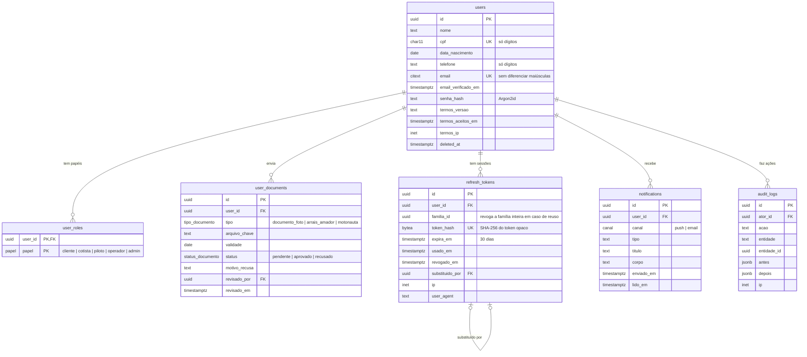
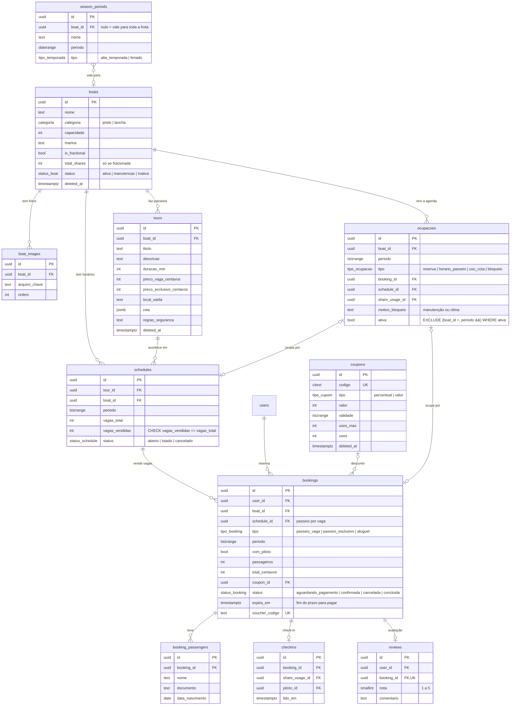
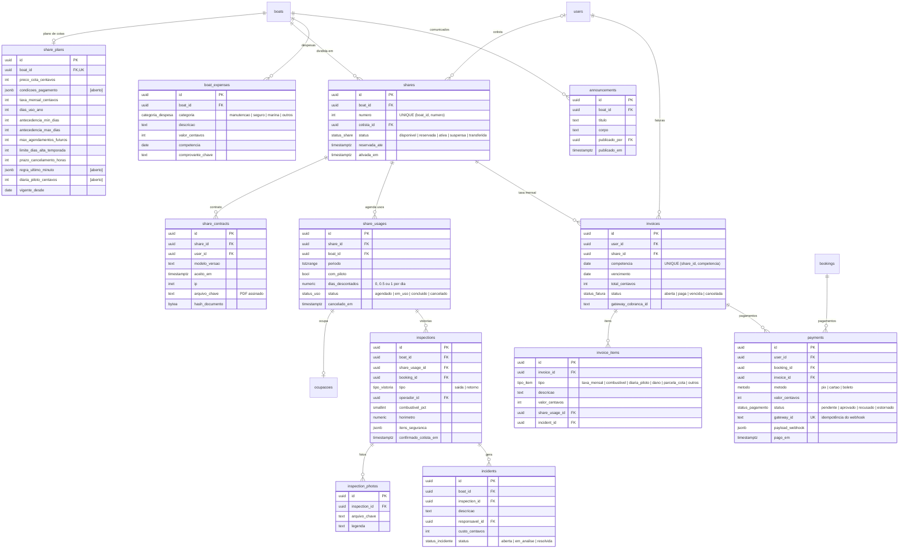

# Modelo de dados — JetBoat

Modelo do banco da API (PostgreSQL 16, migrações pelo Prisma), a partir da lista de tabelas do `docs/prompts/PROMPT_SISTEMA_E_DESENVOLVIMENTO.md` e dos [`REQUISITOS.md`](REQUISITOS.md).

**Última revisão:** 11/11/2026 · **Status:** proposta (nenhuma tabela criada ainda; o banco nasce na Entrega 4) · **Relacionados:** [ADR 0001](adr/0001-concorrencia-das-agendas.md) (concorrência) · [`ARQUITETURA_C4.md`](ARQUITETURA_C4.md) (módulos da API)

**Sumário:** [1. Convenções](#1-convenções) · [2. Conta e acesso](#2-conta-e-acesso) · [3. Frota, passeios e reservas](#3-frota-passeios-e-reservas) · [4. Cotas e financeiro](#4-cotas-e-financeiro) · [5. Restrições e índices](#5-restrições-e-índices-importantes) · [6. Dono de cada tabela](#6-módulo-dono-de-cada-tabela) · [7. Diferenças em relação ao prompt](#7-diferenças-em-relação-à-lista-do-prompt) · [8. Histórico](#8-histórico)

---

## 1. Convenções

| Regra | Como |
|---|---|
| Chave primária | `id uuid` gerado como **UUID v7** (ordenável por tempo) |
| Datas de controle | `created_at`, `updated_at` (`timestamptz`, UTC) em todas as tabelas |
| Exclusão | soft delete (`deleted_at`) em `users`, `boats`, `tours`, `coupons`; o resto é apagado ou só muda de status |
| Dinheiro | sempre **centavos em `integer`** (sufixo `_centavos`), nunca `numeric` com vírgula nem `float` (RNF06) |
| Períodos | `tstzrange` com limite `[início, fim)`; datas de calendário em `daterange` |
| Estados | `enum` do Postgres (listados nos diagramas) |
| Arquivos | só a chave do objeto no S3/MinIO (`*_chave`); o acesso é por URL assinada (RNF03) |
| Nomes | tabelas e colunas em `snake_case`; tabelas em inglês, como no prompt, colunas descritivas |

Nos diagramas abaixo aparecem só as colunas importantes; `created_at` e `updated_at` estão em todas e foram omitidos.

---

## 2. Conta e acesso

---

## 3. Frota, passeios e reservas

---

## 4. Cotas e financeiro

---

## 5. Restrições e índices importantes

| Onde | Regra | Por quê |
|---|---|---|
| `ocupacoes` | `EXCLUDE USING gist (boat_id WITH =, periodo WITH &&) WHERE (ativa)` (extensão `btree_gist`) | nenhuma reserva, horário de passeio, uso de cota ou bloqueio se sobrepõe na mesma embarcação ([ADR 0001](adr/0001-concorrencia-das-agendas.md), RNF05) |
| `ocupacoes` | `CHECK` de que exatamente uma das referências (`booking_id`, `schedule_id`, `share_usage_id`) está preenchida, ou nenhuma quando `tipo = bloqueio` | cada ocupação tem uma origem clara |
| `schedules` | `CHECK (vagas_vendidas <= vagas_total)`; venda por `UPDATE … SET vagas_vendidas = vagas_vendidas + n WHERE vagas_vendidas + n <= vagas_total` | duas reservas por vaga nunca passam da capacidade |
| `shares` | `UNIQUE (boat_id, numero)`; as N cotas são criadas de uma vez com o plano | é impossível vender mais cotas que o total (RF12) |
| `shares` | reservar = `UPDATE … SET status = 'reservada' WHERE id = ? AND status = 'disponivel'` | duas pessoas não reservam a mesma cota |
| `invoices` | `UNIQUE (share_id, competencia)` | o job mensal pode rodar de novo sem duplicar faturas |
| `payments` | `UNIQUE (gateway_id)` | o mesmo webhook processado duas vezes não paga duas vezes |
| `users` | `UNIQUE (cpf)`, `UNIQUE (email)` com `citext`, só entre não excluídos | mesma regra de unicidade do app de hoje |
| `refresh_tokens` | índice em `familia_id`; `UNIQUE (token_hash)` | revogar a família inteira no reuso ([ADR 0004](adr/0004-validade-refresh-token.md)) |
| `bookings` | índice parcial em `expira_em WHERE status = 'aguardando_pagamento'` | o worker cancela reservas não pagas |
| `ocupacoes`, `share_usages`, `schedules` | índice GiST em `(boat_id, periodo)` | calendário e disponibilidade rápidos (RNF04) |

---

## 6. Módulo dono de cada tabela

Só o módulo dono escreve na tabela; os outros leem pelo serviço dele.

| Módulo da API | Tabelas |
|---|---|
| Auth | `refresh_tokens` |
| Users | `users`, `user_roles` |
| Documents | `user_documents` |
| Boats | `boats`, `boat_images`, `season_periods` |
| Tours e Schedules | `tours`, `schedules` |
| Bookings e Check-in | `bookings`, `booking_passengers`, `checkins`, `ocupacoes` (dono da agenda: todos os outros módulos reservam espaço na agenda por ele) |
| Shares | `share_plans`, `shares`, `share_contracts` |
| ShareScheduling | `share_usages` |
| Inspections | `inspections`, `inspection_photos`, `incidents` |
| Billing e Payments | `invoices`, `invoice_items`, `payments`, `coupons` |
| Expenses | `boat_expenses` |
| Notifications, Reviews, Reports | `notifications`, `announcements`, `reviews` |
| Audit | `audit_logs` |

---

## 7. Diferenças em relação à lista do prompt

| Mudança | Motivo |
|---|---|
| **Nova tabela `ocupacoes`** | O prompt pede uma exclusion constraint por embarcação em reservas e em usos de cota. Como elas ficam em tabelas diferentes, o Postgres não impediria uma reserva de aluguel de cair em cima de um dia de cotista. Uma tabela única de ocupações resolve isso ([ADR 0001](adr/0001-concorrencia-das-agendas.md)) e também guarda os bloqueios de manutenção e clima (RF15, RF27), que não tinham tabela. |
| `invoice_items.tipo` inclui `parcela_cota` | Para o caso de compra de cota parcelada [aberto], as parcelas viram itens de fatura. |
| `share_usages.dias_descontados` | Guarda quanto cada uso consumiu do saldo (regra de "último minuto" pode descontar meio dia). |

---

## 8. Histórico

| Data | Mudança |
|---|---|
| 11/11/2026 | Criado (Entrega 1): diagrama ER em três partes, convenções, restrições, módulo dono e a tabela nova `ocupacoes`. |
